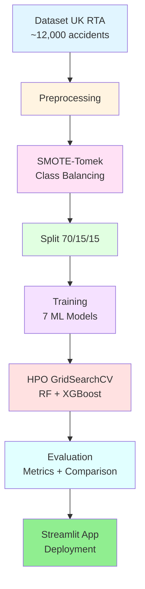

# 🚀 COMMENCEZ ICI - Guide de Démarrage Rapide

Bienvenue dans le projet RTA ML ! Ce guide vous aidera à utiliser et comprendre le projet.

---

## ⚡ Démarrage Ultra-Rapide

### Étape 1: Installer les dépendances
```bash
pip install -r requirements.txt
```

### Étape 2: Lancer l'application Streamlit
```bash
streamlit run app/streamlit_app.py
```

**C'est tout !** L'application est prête à utiliser avec les modèles déjà entraînés. 🎉

---

## 📊 État Actuel du Projet

### ✅ Composants Complétés

```
PROJET_ML_RTA/
├── 📁 data/
│   ├── raw/              ✅ Dataset UK RTA (~12,000 accidents)
│   └── processed/        ✅ Données preprocessées (train/val/test)
├── 📁 src/
│   ├── config.py         ✅ Configuration centralisée
│   ├── preprocessing_pipeline.py  ✅ Pipeline complet
│   ├── training_pipeline.py       ✅ 7 modèles entraînés
│   ├── hpo_pipeline.py            ✅ Optimisation GridSearchCV
│   └── unsupervised_analysis.py   ✅ PCA + K-Means
├── 📁 models/
│   ├── *.pkl             ✅ 7 modèles de base entraînés
│   └── optimized/        ✅ Random Forest + XGBoost optimisés
├── 📁 results/
│   ├── model_comparison.csv       ✅ Comparaison des performances
│   ├── confusion_matrices/        ✅ Matrices de confusion
│   └── unsupervised/              ✅ Résultats PCA/K-Means
├── 📁 app/
│   └── streamlit_app.py  ✅ Application interactive
└── 📁 docs/
    ├── Article_RTA_Project.md     ✅ Article du projet
    └── Presentation_Structure.md  ✅ Structure de présentation
```

### 🎯 Travail Réalisé

- ✅ **Preprocessing** - Nettoyage, outliers, feature engineering, SMOTE-Tomek
- ✅ **Training** - 7 modèles ML entraînés et évalués
- ✅ **Optimisation** - GridSearchCV sur Random Forest et XGBoost
- ✅ **Analyse non-supervisée** - PCA et K-Means implémentés
- ✅ **Application Streamlit** - Interface interactive fonctionnelle
- ✅ **Documentation** - Article et structure de présentation

---

## 🚀 Comment Utiliser le Projet

### 1️⃣ Explorer l'Application Streamlit

```bash
streamlit run app/streamlit_app.py
```

**Fonctionnalités disponibles:**
- 🎯 Sélection du modèle (standard ou optimisé)
- 🔮 Prédictions en temps réel
- 📊 Visualisation des métriques et matrices de confusion
- 📈 Comparaison des performances
- 🔍 Importance des features

### 2️⃣ Ré-exécuter le Pipeline (optionnel)

Si vous voulez régénérer les données ou modèles:

```bash
# Preprocessing (régénère les données processed)
python src/preprocessing_pipeline.py

# Training (ré-entraîne les 7 modèles)
python src/training_pipeline.py

# Analyse non-supervisée
python src/unsupervised_analysis.py

# Optimisation hyperparamètres
python src/hpo_pipeline.py
```

### 3️⃣ Consulter les Résultats

- **Comparaison des modèles**: `results/model_comparison.csv`
- **Matrices de confusion**: `results/confusion_matrices/`
- **Visualisations**: `results/visualizations/`
- **Analyse PCA/K-Means**: `results/unsupervised/`

---

## � Pipeline ML Complet



---

## 🤖 Modèles Disponibles

| Modèle | Type | Statut | Fichier |
|--------|------|--------|---------|
| **Logistic Regression** | Linéaire | ✅ Entraîné | `models/logistic_regression.pkl` |
| **Random Forest** | Ensemble | ✅ Entraîné | `models/random_forest.pkl` |
| **Random Forest Optimized** | Ensemble | ✅ Optimisé | `models/optimized/random_forest_optimized.pkl` |
| **SVM** | Kernel | ✅ Entraîné | `models/svm.pkl` |
| **K-NN** | Instance | ✅ Entraîné | `models/k-nn.pkl` |
| **MLP** | Neural Net | ✅ Entraîné | `models/mlp.pkl` |
| **Naive Bayes** | Probabiliste | ✅ Entraîné | `models/naive_bayes.pkl` |
| **XGBoost** | Boosting | ✅ Entraîné | `models/xgboost.pkl` |
| **XGBoost Optimized** | Boosting | ✅ Optimisé | `models/optimized/xgboost_optimized.pkl` |

---

## � Contraintes Académiques Respectées

### ✅ Toutes les contraintes sont satisfaites !

- ✅ **≥3 Modèles ML** → 7 modèles implémentés
- ✅ **Modèle Probabiliste** → Naive Bayes
- ✅ **Modèle Ensemble** → Random Forest (Bagging) + XGBoost (Boosting)
- ✅ **Analyse Non-Supervisée** → PCA + K-Means
- ✅ **Optimisation Hyperparamètres** → GridSearchCV
- ✅ **Gestion Déséquilibre** → SMOTE-Tomek
- ✅ **Application Démo** → Streamlit
- ✅ **Documentation** → Article + Présentation + README

---

## 📚 Documentation Disponible

| Document | Description | Lien |
|----------|-------------|------|
| **README.md** | Documentation principale complète | [README.md](README.md) |
| **Article** | Article détaillé du projet | [docs/Article_RTA_Project.md](docs/Article_RTA_Project.md) |
| **Présentation** | Structure de présentation | [docs/Presentation_Structure.md](docs/Presentation_Structure.md) |
| **Data README** | Documentation des données | [data/README.md](data/README.md) |

---

## 🎯 Commandes Essentielles

```bash
# UTILISER L'APPLICATION
streamlit run app/streamlit_app.py

# RÉ-EXÉCUTER LE PIPELINE (optionnel)
python src/preprocessing_pipeline.py       # Preprocessing
python src/training_pipeline.py            # Training
python src/unsupervised_analysis.py        # PCA & K-Means
python src/hpo_pipeline.py                 # Optimisation
```

---

## 🆘 Dépannage

### L'application Streamlit ne démarre pas?
```bash
# Réinstaller les dépendances
pip install -r requirements.txt

# Vérifier que Streamlit est installé
streamlit --version
```

### Modèles non trouvés?
Les modèles sont dans `models/` et `models/optimized/`. Si absents, ré-exécutez:
```bash
python src/training_pipeline.py
python src/hpo_pipeline.py
```

### Dataset non trouvé?
Vérifiez que `data/raw/RTA Dataset.csv` existe. Le chemin est configuré dans `src/config.py`.

### Données processed manquantes?
Ré-exécutez le preprocessing:
```bash
python src/preprocessing_pipeline.py
```

---

## ✨ Résumé

- 🏗️ **Architecture modulaire** - Code bien organisé
- � **9 modèles ML** - 7 standards + 2 optimisés
- 📊 **Pipeline complet** - De la donnée brute au déploiement
- 🎨 **Application interactive** - Streamlit fonctionnelle
- 📖 **Documentation complète** - Article, présentation, README
- ✅ **Toutes les contraintes** - Respectées et validées

**Prochaine étape**: Lancez `streamlit run app/streamlit_app.py` et explorez ! 🚀

---

## 🎤 Pour la Présentation

1. **Démo live** - Montrez l'application Streamlit
2. **Résultats** - Consultez `results/model_comparison.csv`
3. **Visualisations** - Utilisez les graphiques dans `results/`
4. **Structure** - Suivez `docs/Presentation_Structure.md`

---

*Dernière mise à jour: Décembre 2025*
